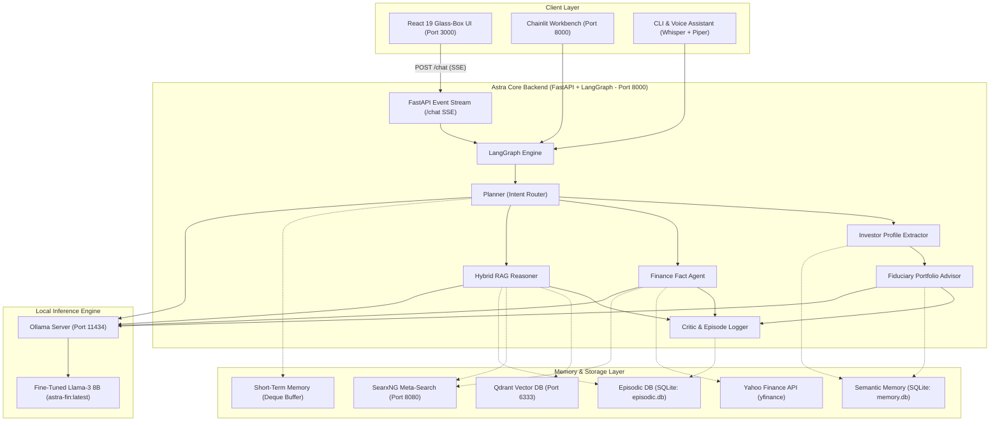
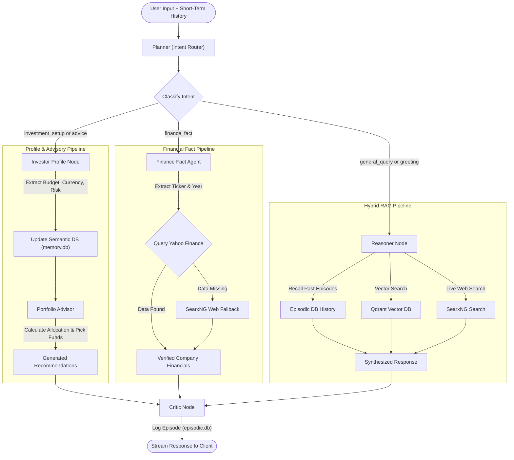

# 🌌 ASTRA: Autonomous Financial Intelligence Platform

[](https://github.com/returnKarthik/Astra-fin/actions)
[](https://www.python.org/)
[](https://fastapi.tiangolo.com/)
[](https://react.dev/)
[](https://langchain-ai.github.io/langgraph/)
[](https://www.docker.com/)
[-purple.svg?style=flat-square)](https://huggingface.co/Harihar-p/astra-fin-lora)
[](LICENSE)

> **A local-first, privacy-preserving Autonomous Financial Intelligence & Advisory Platform.**
> Engineered with a deterministic multi-agent state graph (LangGraph), domain-specialized fine-tuned LLM (`astra-fin`), three-tier memory architecture, real-time "Glass-Box" cognitive observability, and multi-modal voice interaction.

---

## 📑 Table of Contents

- [The Engineering Challenge](#-the-engineering-challenge)
- [System Architecture](#-system-architecture)
- [Key Functionalities & Modules](#-key-functionalities--modules)
- [User Interfaces](#-user-interfaces)
- [Model Engineering & Fine-Tuning](#-model-engineering--fine-tuning)
- [Technology Stack](#-technology-stack)
- [Directory Structure](#-directory-structure)
- [Getting Started](#-getting-started)
  - [Prerequisites](#prerequisites)
  - [1. Environment Configuration](#1-environment-configuration)
  - [2. Model Setup via Ollama](#2-model-setup-via-ollama)
  - [3. Running via Docker Compose (Recommended)](#3-running-via-docker-compose-recommended)
  - [4. Running Locally / Native Development](#4-running-locally--native-development)
- [Interface Modes](#-interface-modes)
- [API Reference](#-api-reference)
- [Testing & Quality Assurance](#-testing--quality-assurance)
- [Evaluation Benchmark](#-evaluation-benchmark)
- [Roadmap](#-roadmap)

---

## ⚡ The Engineering Challenge

Standard conversational LLMs fail when applied directly to financial advisory due to two critical architectural flaws:
1. **Hallucination & Non-Determinism:** General-purpose LLMs hallucinate financial metrics, invent company revenues, and provide inconsistent asset allocations without mathematical guarantees.
2. **Statelessness & Context Drift:** Generic chat wrappers lack structured, persistent memory for tracking changing user capital, risk profiles, horizons, and conversational history across sessions.

**ASTRA** solves these challenges by combining an **agentic state-machine** with **deterministic financial logic**:
- **Domain Specialization:** Runs on `astra-fin`, a custom QLoRA fine-tuned Llama-3 8B model trained on 10,000+ financial QA pairs for fiduciary reasoning.
- **Deterministic Guardrails:** Financial calculations, portfolio allocation rules, and numerical extraction are decoupled from unstructured generation and verified through deterministic Python modules.
- **"Glass-Box" Observability:** Rather than a black-box chatbot, ASTRA streams its real-time planning states, intent classification, and live memory updates directly to the frontend.
- **Three-Tier Memory Architecture:** Separates ephemeral context, persistent episodic conversation logs, and structured semantic investor profiles.
- **Local-First Privacy:** Operates 100% locally with Ollama, Qdrant, and SearxNG—no sensitive financial information leaves your private network.

---

## 🏗️ System Architecture

ASTRA is built as a microservices architecture orchestrated via **Docker Compose**:



### LangGraph Execution Flow



---

## 💡 Key Functionalities & Modules

### 1. Intelligent Intent Routing (`src/agents/planner.py`)
- Ingests recent multi-turn context (via short-term memory ring buffer) and current query.
- Classifies user inputs into 7 deterministic operational intents:
  - `investment_setup`: User shares budget, capital, or risk constraints (e.g., *"I have 50,000 INR to invest"*).
  - `investment_advice`: User requests portfolio allocations or recommendations (e.g., *"Where should I allocate my savings?"*).
  - `finance_fact`: Queries requesting specific corporate data or metrics (e.g., *"What was Apple's revenue in 2023?"*).
  - `memory_question`: Queries exploring past discussions (e.g., *"What did we talk about earlier?"*).
  - `greeting`: Polite introductory exchanges.
  - `identity`: Agent capability and persona queries.
  - `general_query`: Broad financial discussions and general inquiries.

### 2. Investor Profiling & Entity Extraction (`src/profile/investor_profile.py`)
- **Multi-Currency Support:** Detects INR (`₹`, `rupees`, `rs`, `inr`) and USD (`$`, `usd`, `dollars`).
- **Flexible Numeric Normalization:** Extracts values formatted as `50k`, `1.5m`, `20,000`, etc., while disambiguating calendar years (`2024`) from capital figures.
- **Risk Characterization:** Identifies low/conservative, medium/balanced, and high/aggressive profiles.
- **Horizon Tracking:** Resolves short-term vs. long-term goals and updates the Semantic Memory database automatically.

### 3. Fiduciary Portfolio Allocation Engine (`src/portfolio/`, `src/risk/`, `src/advisory/`)
- **Deterministic Asset Allocation:**
  - **Aggressive:** 70% Equity, 10% Debt, 10% Gold, 10% Alternatives.
  - **Balanced:** 50% Equity, 30% Debt, 20% Gold.
  - **Conservative:** 30% Equity, 50% Debt, 20% Gold.
- **Market-Specific Vehicle Recommendations:**
  - **INR (India Market):** Quant Small Cap, Nippon India Small Cap, UTI Nifty 50 Index Fund, Parag Parikh Flexi Cap Fund, HDFC Short Term Debt, HDFC Liquid Fund, Bank FDs.
  - **USD (US Market):** Invesco QQQ (Tech ETF), Vanguard Growth ETF (VUG), Vanguard Total Stock Market (VTI), US Treasury Bills.
- **Fiduciary Response Template:** Analysis &rarr; Allocation Breakdown &rarr; Named Fund Recommendations &rarr; Rationale / Risk Justification.

### 4. Deterministic Financial Tools & Web Search (`src/tools/finance.py`, `src/retrieval/web.py`)
- Direct integration with **Yahoo Finance (`yfinance`)** for precise balance-sheet and income-statement metrics (Total Revenue, Market Cap).
- Fallback meta-search via **SearxNG** with automated financial domain scoping (`site:sec.gov`, `site:wikipedia.org`, official investor relations).
- Memory-locking mechanism prevents hallucinated facts from overwriting verified corporate data.

### 5. Three-Tier Memory Architecture (`src/memory/`)
| Memory Type | Implementation | Persistence | Purpose |
|---|---|---|---|
| **Short-Term** | `collections.deque(maxlen=6)` | In-Memory | Retains immediate dialogue context for intent resolution. |
| **Episodic** | SQLite (`data/episodic.db`) | Disk | Logs timestamped query-response pairs for conversational recall (`"What did we discuss?"`). |
| **Semantic** | SQLite (`data/memory.db`) | Disk | Stores key-value user preferences (`budget`, `currency`, `risk`, `horizon`) across sessions. |

### 6. Hybrid Retrieval-Augmented Generation (`src/retrieval/`)
- Blends private semantic vector search against internal institutional research (`QdrantVectorStore` on port 6333) with real-time public web search (`SearxNG` on port 8080).
- Seeded with internal financial memos, research notes, and risk reports via `scripts/seed_db.py`.

### 7. Multi-Modal Voice Interaction Loop (`src/voice/`)
- **Speech-to-Text (STT):** OpenAI Whisper (`whisper.load_model("base")`) with energy-based silence detection.
- **Audio Capture:** Real-time microphone capture using `sounddevice` and `scipy`.
- **Text-to-Speech (TTS):** Low-latency local neural voice synthesis using **Piper TTS** with the ONNX model (`en_US-lessac-medium.onnx`).

### 8. Reliability Guardrails (`src/agents/`)
- **Temporal Guard (`temporal_guard.py`):** Rejects forward-looking or unreleased financial periods (e.g. queries asking for 2027 revenue).
- **Number Normalizer (`normalizer.py`):** Automatically standardizes mixed currency figures into standard billion/million USD notations.
- **Verifier (`verifier.py`):** Assesses context grounding before returning speculative answers.

---

## 🖥️ User Interfaces

ASTRA provides 4 distinct interfaces designed for different operational needs:

1. **"Glass-Box" Web UI (React + Tailwind + Vite):**
   - Live **Planner Telemetry**: Watch the agent classify intents in real time.
   - Live **Semantic Memory Feed**: Real-time display of extracted budget, currency, and risk attributes.
   - Streaming Server-Sent Events (SSE) chat feed.
2. **Chainlit Developer Workbench (`src/app.py`):**
   - Step-by-step cognitive traces with interactive expandable thoughts for debugging graph nodes.
3. **Interactive Terminal CLI (`src/main.py`):**
   - Lightweight text-based shell for headless environments.
4. **Voice Assistant Mode (`src/voice/voice_loop.py`):**
   - Hands-free conversational interface with local Whisper STT and Piper ONNX TTS.

---

## 🧠 Model Engineering & Fine-Tuning

Unlike standard wrappers relying on commercial black-box models, ASTRA is powered by **`astra-fin`**, an aligned financial reasoning model:

- **Base Architecture:** `Llama-3-8B-Instruct`
- **Fine-Tuning Framework:** [Unsloth](https://github.com/unslothai/unsloth) (2x faster backpropagation, reduced VRAM)
- **Adaptation Method:** QLoRA (Rank r=16, Alpha=16, 4-bit NormalFloat Quantization)
- **Dataset:** `virattt/financial-qa-10k` (10,000+ curated financial QA instruction pairs)
- **Inference Packaging:** Converted to **GGUF `Q4_K_M`** for local inference on Apple Silicon (Metal) and consumer x86 GPUs/CPUs.
- **Hugging Face Model Hub:** [Harihar-p/astra-fin-lora](https://huggingface.co/Harihar-p/astra-fin-lora)
- **Ollama Configuration (`Modelfile`):**
  ```dockerfile
  FROM ./llama-3-8b-instruct.Q4_K_M.gguf
  SYSTEM "You are Astra, a Senior Investment Analyst. Answer with strict financial data. Be concise."
  PARAMETER temperature 0.1
  ```

---

## 🛠️ Technology Stack

| Layer | Technology | Description |
|---|---|---|
| **Core Framework** | Python 3.11+, LangGraph, LangChain | State machine graph orchestration & multi-agent routing |
| **API Server** | FastAPI, Uvicorn, SSE | Async REST API streaming Server-Sent Events |
| **Frontend** | React 19, Vite, Tailwind CSS, Lucide | Responsive "Glass-Box" cognitive telemetry interface |
| **LLM Inference** | Ollama, LLaMA-3 8B Instruct | Local GGUF quantized model execution |
| **Fine-Tuning** | Unsloth, Hugging Face PEFT, QLoRA | Parameter-efficient fine-tuning on financial datasets |
| **Vector Database** | Qdrant | High-performance semantic vector database |
| **Private Search** | SearxNG | Local privacy-preserving meta-search engine |
| **Financial Tools** | yfinance, pandas | Real-time equity and balance sheet metrics |
| **Local Memory** | SQLite3 | Episodic dialogue history and semantic profile stores |
| **Voice / Speech** | OpenAI Whisper, Piper TTS (ONNX), sounddevice | Local speech-to-text and neural text-to-speech |
| **DevOps & CI/CD** | Docker, Docker Compose, GitHub Actions | Multi-container deployment & automated unit tests |

---

## 📁 Directory Structure

```text
Astra-Fin-Agent/
├── .chainlit/                # Chainlit UI configurations & localization files
├── .github/
│   └── workflows/
│       └── ci.yml            # CI pipeline executing pytest on PR / push
├── data/
│   ├── episodic.db           # SQLite database storing historical dialogue sessions
│   ├── memory.db             # SQLite database storing user semantic risk/budget profiles
│   └── eval/
│       └── finance_eval.json # Benchmark dataset for evaluating financial grounding
├── frontend/                 # React 19 + Vite + Tailwind "Glass-Box" UI
│   ├── src/
│   │   ├── App.jsx           # Main UI with SSE stream client & live memory panes
│   │   ├── main.jsx          # React DOM entrypoint
│   │   └── index.css         # Tailwind styling
│   ├── Dockerfile            # Multi-stage build (Node 18 -> Nginx Alpine)
│   ├── package.json          # Frontend dependencies
│   └── vite.config.js        # Vite build configuration
├── models/
│   └── tts/
│       ├── en_US-lessac-medium.onnx      # Piper ONNX neural voice model
│       └── en_US-lessac-medium.onnx.json # Piper model voice hyperparameters
├── scripts/
│   ├── seed_db.py            # Ingests institutional research into Qdrant
│   └── setup_model.sh        # Automates Ollama model registration from Modelfile
├── searxng/
│   └── settings.yml          # Customized SearxNG configuration (JSON API enabled)
├── src/                      # Core backend Python source
│   ├── advisory/
│   │   └── advisor.py        # Fiduciary portfolio advisor and asset allocation formatter
│   ├── agents/
│   │   ├── planner.py        # Multi-intent classifier and conversation router
│   │   ├── finance_agent.py  # Structured financial fact retriever (yfinance + web)
│   │   ├── reasoner.py       # Hybrid RAG & conversational reasoning engine
│   │   ├── critic.py         # Post-execution review & episodic logging sink
│   │   ├── verifier.py       # Hallucination guard & context verification
│   │   ├── normalizer.py     # Monetary amount parser and normalizer
│   │   └── temporal_guard.py # Guardrail against forward-looking calendar queries
│   ├── core/
│   │   ├── config.py         # Pydantic environment settings
│   │   ├── llm.py            # ChatOllama client factory
│   │   └── embeddings.py     # Ollama nomic-embed-text embeddings client
│   ├── eval/
│   │   ├── metrics.py        # Groundedness & latency evaluation harness
│   │   └── run_eval.py       # Evaluation benchmark execution script
│   ├── graph/
│   │   ├── astra_graph.py    # StateGraph compilation, node mapping, conditional edges
│   │   └── state.py          # TypedDict AstraState schema definition
│   ├── memory/
│   │   ├── short_term.py     # In-memory deque ring buffer for prompt history
│   │   ├── episodic.py       # SQLite interface for timestamped interaction logs
│   │   └── semantic.py       # SQLite key-value store for user financial parameters
│   ├── portfolio/
│   │   └── allocator.py      # Quantitative asset allocation weighting logic
│   ├── profile/
│   │   └── investor_profile.py # Regex & heuristic financial profile extractor
│   ├── retrieval/
│   │   ├── vector.py         # Qdrant client & vector search helpers
│   │   ├── web.py            # SearxNG HTTP search client
│   │   └── hybrid.py         # Vector + web search result aggregator
│   ├── risk/
│   │   └── risk_engine.py    # Risk classification logic (conservative, balanced, aggressive)
│   ├── tools/
│   │   └── finance.py        # yfinance integration for balance sheet & revenue extraction
│   ├── voice/
│   │   ├── record.py         # Microphone recording via sounddevice
│   │   ├── stt.py            # Speech-to-text via Whisper
│   │   ├── tts.py            # Text-to-speech via Piper TTS
│   │   └── voice_loop.py     # Continuous voice interaction loop
│   ├── app.py                # Chainlit web application
│   ├── main.py               # CLI entrypoint (text and voice modes)
│   └── server.py             # FastAPI backend with Server-Sent Events (/chat)
├── tests/
│   ├── test_brain.py         # Unit tests with mock LLM for CI execution
│   └── test_flow.py          # End-to-end multi-turn conversation flow tests
├── .env                      # Environment configuration file
├── docker-compose.yml        # Docker multi-service orchestration
├── Dockerfile                # Backend container definition
├── Modelfile                 # Ollama model definition file
├── pyproject.toml            # Python package specifications & dependencies
└── README.md                 # Project documentation
```

---

## 🚀 Getting Started

### Prerequisites

- [Docker Desktop](https://www.docker.com/products/docker-desktop/) installed and running.
- [Ollama](https://ollama.com/) installed on your host machine.
- Python 3.11+ (if running outside Docker).
- Node.js 18+ (if running the frontend locally).

---

### 1. Environment Configuration

Create a `.env` file in the root directory (or use the existing one):

```ini
# LangSmith Tracing (Optional)
LANGCHAIN_TRACING_V2=true
LANGCHAIN_ENDPOINT="https://api.smith.langchain.com"
LANGCHAIN_API_KEY="your-langchain-api-key"
LANGCHAIN_PROJECT="astra-fin-pro"

# Service URLs
QDRANT_URL="http://localhost:6333"
SEARXNG_URL="http://localhost:8080"
OLLAMA_BASE_URL="http://localhost:11434"

# Models
MODEL_NAME="astra-fin:latest"
EMBED_MODEL="BAAI/bge-base-en-v1.5"

# External Search (Optional fallback)
TAVILY_API_KEY="your-tavily-api-key"
```

---

### 2. Model Setup via Ollama

Ensure your quantized model file (`llama-3-8b-instruct.Q4_K_M.gguf`) is placed in the project root directory.

1. Start the Ollama daemon on your host, binding to all interfaces so Docker containers can reach it:
   ```bash
   # Linux/macOS
   OLLAMA_HOST=0.0.0.0 ollama serve

   # Windows (PowerShell)
   $env:OLLAMA_HOST="0.0.0.0"
   ollama serve
   ```

2. Register the fine-tuned `astra-fin` model:
   ```bash
   ollama create astra-fin -f Modelfile
   ```

3. Pull the embedding model for Qdrant vector retrieval:
   ```bash
   ollama pull nomic-embed-text
   ```

---

### 3. Running via Docker Compose (Recommended)

To launch the full microservices stack (React Frontend, FastAPI Backend, Qdrant Vector DB, and SearxNG Search Engine):

```bash
docker-compose up --build
```

#### Service Endpoints:
- **Glass-Box React UI:** [http://localhost:3000](http://localhost:3000)
- **FastAPI Backend & Interactive Swagger Docs:** [http://localhost:8000/docs](http://localhost:8000/docs)
- **Qdrant Vector Dashboard:** [http://localhost:6333/dashboard](http://localhost:6333/dashboard)
- **SearxNG Meta-Search Engine:** [http://localhost:8080](http://localhost:8080)

---

### 4. Running Locally / Native Development

If you prefer running services directly on your host machine:

#### Step A: Start Infrastructure Services
You can run Qdrant and SearxNG using Docker:
```bash
docker run -d -p 6333:6333 -v qdrant_storage:/qdrant/storage qdrant/qdrant:latest
docker run -d -p 8080:8080 -v ./searxng:/etc/searxng searxng/searxng:latest
```

#### Step B: Install Python Dependencies
```bash
python -m venv .venv

# On Linux/macOS
source .venv/bin/activate
# On Windows
.venv\Scripts\activate

pip install -e .
pip install fastapi uvicorn httpx pytest
```

#### Step C: Seed Vector Database
```bash
python scripts/seed_db.py
```

#### Step D: Run the Backend API
```bash
python -m src.server
```

#### Step E: Run the React Frontend
```bash
cd frontend
npm install
npm run dev
```
Open [http://localhost:5173](http://localhost:5173) in your browser.

---

## 🎮 Interface Modes

### 1. Chainlit Developer Workbench
For visual, interactive inspection of LangGraph agent steps:
```bash
chainlit run src/app.py -w
```
Navigate to [http://localhost:8000](http://localhost:8000) to trace agent decisions step-by-step.

### 2. Interactive Terminal CLI
For quick command-line interaction:
```bash
python src/main.py
# Select 'text' when prompted
```

### 3. Voice Assistant Mode
To speak directly with ASTRA using local Whisper STT and Piper TTS:
```bash
python src/main.py
# Select 'voice' when prompted
```
*(Ensure a working microphone is connected. Speech will be transcribed locally and vocalized through Piper ONNX).*

---

## 📡 API Reference

### `POST /chat`
Streams real-time cognitive state transitions and response tokens using **Server-Sent Events (SSE)**.

- **Request Body:**
  ```json
  {
    "query": "I have 50,000 INR and want high risk investments."
  }
  ```

- **SSE Stream Protocol (`text/event-stream`):**
  ```text
  data: {"type": "brain", "content": "Intent: INVESTMENT_SETUP"}

  data: {"type": "memory", "content": "Budget: 50000 INR | Risk: high"}

  data: {"type": "response", "content": "1. **Analysis**: Based on your total budget of 50000 INR...\n2. **Allocation Plan**:\n- Equity: 70%\n- Debt: 10%\n- Gold: 10%\n- Alternative: 10%\n\n3. **Specific Recommendations**:\nFor Equity, I recommend 'Quant Small Cap Fund' or 'Nippon India Small Cap'.\nFor Debt, consider 'HDFC Short Term Debt Fund'.\n\n4. **Why?**:\nAn aggressive asset allocation maximizes long-term compounding while maintaining minimal liquidity."}
  ```

### `GET /health`
Returns service status.
- **Response:**
  ```json
  {
    "status": "ok"
  }
  ```

---

## 🧪 Testing & Quality Assurance

ASTRA employs a dual-stage testing strategy to guarantee reliability:

### 1. Unit Testing with Mocked LLM (`tests/test_brain.py`)
Decouples application logic from heavy GPU inference using `unittest.mock`. This allows fast validation in non-GPU CI/CD runners:
- Verifies Planner intent classification routing.
- Validates regex-based financial parameter extraction across currencies.
- Validates structural integrity of Fiduciary Advisor allocation templates.

Run unit tests:
```bash
pytest tests/test_brain.py -v
```

### 2. Integration Testing (`tests/test_flow.py`)
Validates end-to-end conversation flows with active Ollama inference:
```bash
pytest tests/test_flow.py -v
```

### 3. Continuous Integration
The GitHub Actions workflow (`.github/workflows/ci.yml`) runs automatically on every push and pull request to `main`, validating code changes against the Python 3.11 test suite.

---

## 📊 Evaluation Benchmark

ASTRA includes an automated evaluation pipeline (`src/eval/run_eval.py`) to measure answer accuracy and grounding against financial ground truth (`data/eval/finance_eval.json`):

```bash
python -m src.eval.run_eval
```

**Benchmark Metrics:**
- **Grounded Accuracy:** Proportion of answers grounded strictly in retrieved context or verified tools.
- **Inference Latency:** End-to-end turnaround time per question (seconds).

---

## 🗺️ Roadmap

- [x] **Phase 1: Agent State Machine & Hybrid Memory** (LangGraph, SQLite Semantic/Episodic stores)
- [x] **Phase 2: Fine-Tuning Financial LLM** (Unsloth QLoRA on Llama-3 8B, GGUF export)
- [x] **Phase 3: "Glass-Box" Reactive Interface** (React 19, Tailwind, SSE streaming)
- [x] **Phase 4: Multi-Modal Voice Pipeline** (OpenAI Whisper + Piper ONNX)
- [x] **Phase 5: Microservice Orchestration** (Docker Compose with Qdrant and SearxNG)
- [x] **Phase 6: CI/CD & Mock Testing Suite** (GitHub Actions + Pytest)
- [ ] **Phase 7: Real-Time Brokerage Integration** (Alpaca / Zerodha Kite Connect API)
- [ ] **Phase 8: Multi-User Tenant Partitioning** (PostgreSQL / Row-Level Security for enterprise deployment)

---

## 📄 License

This project is licensed under the MIT License. See the [LICENSE](LICENSE) file for details.
